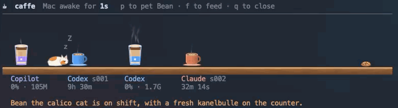

# ☕ caffe

`caffeinate`, but with a coffee bar. Keeps your Mac awake and serves a steaming
cup for every AI coding agent you have running.



- **Keeps the Mac awake** until you quit (`caffeinate -dimsu` under the hood).
- **Battery aware.** Unplugged at 20% or less, the display may sleep while the
  system stays awake, so your agents keep running. Plug in and the display
  stays on again. The header shows the charge while you're on battery.
- **Espressos for CLI sessions.** Copilot CLI, Codex CLI, Claude Code and Pi
  sessions running in a terminal get small cups and saucers, each in its own
  colour. New ones pour in, and finished ones drain and turn grey.
- **Lattes for applications.** Codex, Copilot, Claude and VS Code each get a
  latte named and coloured for the application. Helpers and agent backends
  belong to that app's drink. These cups track open applications, rather than
  individual chats, and stay on the bar while the app is open.
- **Steam follows the work.** The more CPU an agent uses, the more its cup
  steams. App lattes show total CPU percentage and resident RAM for the app
  and its descendants. They steam lightly at 3% CPU or 256 MiB, and heavily
  at 25% CPU or 1 GiB. Resource totals include terminal agents hosted by VS Code,
  which also retain their individual espressos.
- **Copilot session mugs.** Running local Copilot app sessions and chats get
  individual espressos labeled `Agent` in the spawning app's color.
  They steam and show `working`; idle sessions disappear without being served.
- **A barista cat.** A random name and coat each launch. It walks behind the
  cups, checks on new ones, grooms, yawns and naps when things are quiet. It
  knocks every finished cup off the bar.
- **Pet the cat** with `p`. It purrs.
- **Feed the cat** with `f`. It munches a fish treat, up to three every ten
  minutes before it's full.
- **Mice.** Now and then a mouse dashes along the counter and the cat gives
  chase. A slow mouse gets caught (and let go); a fast one escapes. A napping
  cat sleeps right through it. Mice come out more at night.
- **Visiting cats.** A stray wanders in every so often. A cat that's been
  petted or fed lately shares the counter for a while; a grumpy one usually
  hisses it out.
- **Time of day.** Mornings open with a greeting. From 23:00 the cat takes the
  night shift: it walks slower, naps more and gets its own quips. At 14:30
  there's fika: a kanelbulle on the counter, or a lussekatt in December. While
  agents work, the cat sneaks a bite now and then.
- **Rush hour.** With four or more agents working at once, the cat hurries.
- **Lots of agents?** Cups shrink to fit the screen. Anything that still
  doesn't fit is counted below the counter.
- **Receipt on quit:** an order number, your espressos per agent, the cups the
  cat broke, the mice it caught, time awake against total agent time, the
  longest session, visiting cats, and the cat's tip in pets and treats. Open
  apps and Copilot activity-only mugs don't count.

## Install

```sh
curl -fsSL https://raw.githubusercontent.com/alexgnq/caffe/main/install.sh | sh
```

Installs to `~/.local/bin/caffe`. Set `CAFFE_BIN_DIR` to install somewhere else.
Requires macOS and `python3` (included with the Xcode Command Line Tools). No
other dependencies.

The pictures need a terminal that supports the
[kitty graphics protocol](https://sw.kovidgoyal.net/kitty/graphics-protocol/),
such as Ghostty, kitty, WezTerm or a recent iTerm2. In other terminals, and
inside tmux, caffe still keeps the Mac awake and lists your agents, just without
pictures.

## Usage

```sh
caffe
```

Press `p` to pet the cat, `f` to feed it, and `q` or `Ctrl-C` to close the bar.
`caffe --help` prints a short summary.

To update to the latest version:

```sh
caffe update
```

`caffe update` installs the upstream version and replaces local customizations,
including Copilot session tracking and app resource reporting.

## How it works

- Every 3 seconds, `ps` is checked for `copilot`, `codex`, `claude` and `pi`
  processes attached to a terminal, and for the Codex, Copilot, Claude and
  VS Code apps. An app's helpers and agent backends count towards its latte.
- Copilot's local, running, unarchived project, agent and general-chat sessions
  are read from `~/.copilot/data.db` in read-only mode. Only session metadata
  is read, never conversation history. This optional integration uses an
  undocumented schema; if a read fails, existing session mugs are kept until
  the next successful read.
- `caffeinate` is tied to caffe's process ID, so the Mac can sleep again as soon
  as caffe exits, even if it's killed.
- Every 30 seconds, `pmset -g batt` is read. On a low battery caffe restarts
  `caffeinate` as `-ims`, without the display (`-d`) and user-activity (`-u`)
  assertions.
- The art is drawn in Python when it's first needed and sent to the terminal
  once. After that caffe only moves the pictures around, redraws only the text
  that changed, and slows down when nothing is moving, so it uses very little
  CPU.
- caffe stores nothing on disk.

## Uninstall

```sh
rm ~/.local/bin/caffe
```

## License

[MIT](LICENSE)
